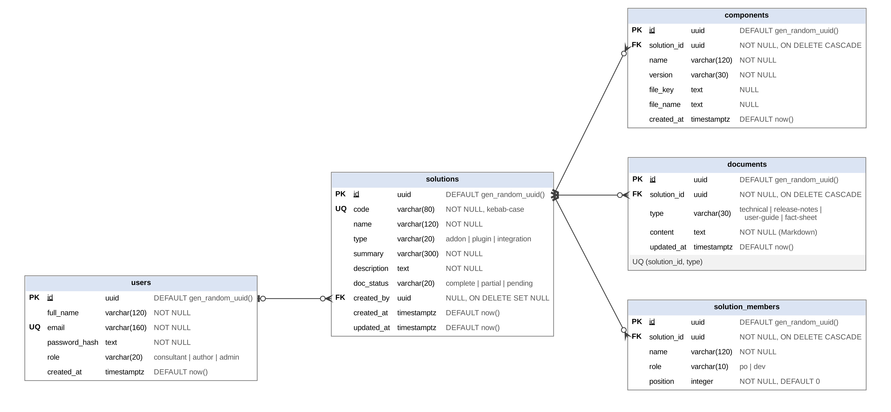
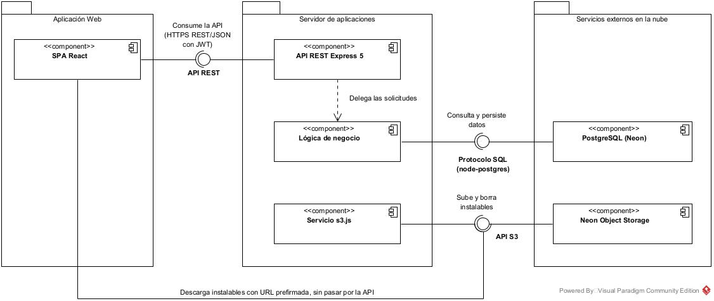

# Knowledge Base Portal

Prototipo de alta fidelidad de un portal web interno que centraliza la documentación técnica y funcional de soluciones de software: add-ons de ERP, plugins de punto de venta (POS) e integraciones. Los consultores encuentran en un solo lugar la ficha de cada solución, sus responsables, los instalables de sus componentes y sus secciones de documentación; los autores técnicos la mantienen al día.

Caso de estudio de la materia **Interacción Humano-Computadora (CSE661)**, Broward International University, **Tarea de Asignación 2**: prototipo de alta fidelidad con operaciones CRUD sobre una base de datos.

> El prototipo se demostró en funcionamiento durante la presentación en clase y se ejecuta en local siguiendo las instrucciones de este documento.

## Estructura del repositorio

| Carpeta | Fase de la tarea | Contenido |
|---|---|---|
| [`Design/`](Design/) | Fase de Diseño | Diagramas (`diagrams/`) y referencias visuales del wireframe en Figma (`reference/wireframe/`) y del mockup en Axure RP (`reference/mockup/`). |
| [`Backend/`](Backend/) | Fase 2 | API REST en Node.js + Express: esquema y seed de la base de datos (`db/`), código fuente (`src/`) y especificación de la API ([`API.md`](Backend/API.md)). |
| [`Frontend/`](Frontend/) | Fase 3 | Aplicación web en React + Vite (`src/`) y guía de uso ([`README.md`](Frontend/README.md)). |
| [`Testing/`](Testing/) | Pruebas (Fase 4) | Colección de Postman (`knowledge-portal.postman_collection.json`) e informe de pruebas manuales ([`test-report.md`](Testing/test-report.md)). |

## Stack

**Backend** (`Backend/package.json`, Node.js 20 o superior)

- Express 5, con `helmet` (cabeceras de seguridad) y `cors`.
- PostgreSQL en Neon mediante `pg` con SQL directo (sin ORM).
- Autenticación con `jsonwebtoken` (JWT de 8 horas) y contraseñas con `bcryptjs`.
- Validación de entradas con `zod`.
- Subida de archivos con `multer` (en memoria, límite de 50 MB).
- Almacenamiento de instalables en Neon Object Storage, compatible con S3, mediante `@aws-sdk/client-s3` y `@aws-sdk/s3-request-presigner` (descarga con URL prefirmada de 5 minutos).
- Configuración con `dotenv`.

**Frontend** (`Frontend/package.json`)

- React 19 + Vite 8 (`@vitejs/plugin-react`).
- `react-router-dom` 7 para la navegación.
- `react-markdown` con `remark-gfm` (tablas), `rehype-raw` y `rehype-sanitize` para mostrar la documentación en Markdown con videos embebidos de forma segura.
- CSS propio, sin framework de interfaz, con modo claro y oscuro.

## Modelo de datos

Definido en [`Backend/db/schema.sql`](Backend/db/schema.sql). Todas las claves primarias son `UUID` generados con `gen_random_uuid()`.

| Tabla | Propósito |
|---|---|
| `users` | Usuarios del portal, con su rol (`consultant`, `author` o `admin`). |
| `solutions` | Ficha de cada solución: `code` (slug único e inmutable), nombre, tipo (`addon`, `plugin`, `integration`), resumen, descripción en Markdown y estado documental (`complete`, `partial`, `pending`). |
| `solution_members` | Responsables de una solución: como máximo un Product Owner (`po`) y varios desarrolladores (`dev`). |
| `components` | Componentes de una solución con su versión y, opcionalmente, la clave del instalable en el almacenamiento de objetos. |
| `documents` | Secciones de documentación de una solución (`technical`, `release-notes`, `user-guide`, `fact-sheet`), una fila por sección con su Markdown completo. |

## Fase de Diseño

### Diagramas

- Modelo de la base de datos: [`Design/diagrams/database-model.png`](Design/diagrams/database-model.png)

  

- Diagrama de componentes: [`Design/diagrams/knowledge-base-portal-componentes.jpg`](Design/diagrams/knowledge-base-portal-componentes.jpg)

  

### Referencias visuales

| Pantalla | Wireframe (Figma) | Mockup (Axure RP) |
|---|---|---|
| Ingreso | [01-login.png](Design/reference/wireframe/01-login.png) | [01-login.png](Design/reference/mockup/01-login.png) |
| Página principal | [02-home.png](Design/reference/wireframe/02-home.png) | [02-home.png](Design/reference/mockup/02-home.png) |
| Ficha de la solución | [03-solution-detail.png](Design/reference/wireframe/03-solution-detail.png) | [03-solution-detail.png](Design/reference/mockup/03-solution-detail.png) |
| Aviso de descarga | — | [03b-download-toast.png](Design/reference/mockup/03b-download-toast.png) |
| Documentación | [04-documentation.png](Design/reference/wireframe/04-documentation.png) | [04-documentation.png](Design/reference/mockup/04-documentation.png) |

## Ejecución local en Windows

### Requisitos

- **Node.js 20 o superior** (incluye npm). Compruébalo con `node -v`.
- Una base de datos **PostgreSQL 13 o superior**; el proyecto usa Neon (plan gratuito).
- Un bucket privado compatible con S3; el proyecto usa Neon Object Storage del mismo proyecto de Neon.

Los comandos siguientes funcionan en PowerShell o en el Símbolo del sistema; no se necesita bash.

### 1. Configurar las variables de entorno

```powershell
cd Backend
copy .env.example .env
```

Abre `Backend/.env` y completa cada variable:

| Variable | Descripción |
|---|---|
| `PORT` | Puerto de la API. Por defecto `3000`; el proxy del frontend apunta a ese puerto. |
| `DATABASE_URL` | Cadena de conexión de PostgreSQL de Neon, con `sslmode=require`. **Obligatoria**. |
| `JWT_SECRET` | Cadena larga y aleatoria con la que se firman los tokens de sesión. **Obligatoria**. |
| `ADMIN_EMAIL` | Correo del administrador que crea el seed. |
| `ADMIN_PASSWORD` | Contraseña del administrador del seed (8 caracteres o más). |
| `ADMIN_NAME` | Nombre visible del administrador (por defecto, `Administrador`). |
| `AWS_REGION` | Región del almacenamiento de objetos (por ejemplo, `us-east-2`). |
| `AWS_ENDPOINT_URL_S3` | Endpoint S3 del almacenamiento. Con Neon Object Storage se obtiene en la consola de Neon o con `neon env pull`; para AWS S3 se deja vacío. |
| `AWS_ACCESS_KEY_ID` | Clave de acceso del almacenamiento. |
| `AWS_SECRET_ACCESS_KEY` | Clave secreta del almacenamiento. |
| `S3_BUCKET` | Nombre del bucket privado donde se guardan los instalables. |
| `CORS_ORIGIN` | Origen permitido por CORS; en local, `http://localhost:5173`. |

El servidor no arranca si faltan `DATABASE_URL` o `JWT_SECRET`. Sin las variables de almacenamiento, todo funciona salvo la subida y descarga de instalables.

### 2. Instalar dependencias

```powershell
cd Backend
npm install
cd ..\Frontend
npm install
```

### 3. Crear la base de datos y cargar los datos de ejemplo

Desde `Backend/`:

```powershell
npm run db:init
npm run db:seed
```

- `db:init` ejecuta `db/schema.sql`. **Borra y vuelve a crear todas las tablas**, así que elimina los datos existentes.
- `db:seed` crea el administrador a partir de `ADMIN_EMAIL`, `ADMIN_PASSWORD` y `ADMIN_NAME`, y carga tres soluciones de ejemplo: *Asistente de Accesibilidad* (documentación completa, con responsables, componentes y las cuatro secciones), una con documentación parcial y otra pendiente. Se puede ejecutar varias veces sin duplicar datos.

### 4. Levantar el backend y el frontend

Usa dos terminales:

```powershell
# Terminal 1, en Backend/
npm run dev      # o npm start, sin recarga automática
```

```powershell
# Terminal 2, en Frontend/
npm run dev
```

| Servicio | URL |
|---|---|
| Aplicación web | http://localhost:5173 |
| API | http://localhost:3000/api |

En desarrollo, Vite redirige las peticiones a `/api` hacia `http://localhost:3000`, de modo que el frontend usa rutas relativas.

## Roles y permisos

| Rol (`role`) | Etiqueta en la interfaz | Permisos |
|---|---|---|
| `consultant` | Consultor | Consultar el catálogo, las fichas y la documentación; descargar instalables. |
| `author` | Autor técnico | Lo anterior, más crear, editar y eliminar soluciones, responsables, componentes y secciones de documentación. |
| `admin` | Administrador | Lo anterior, más listar usuarios, cambiar su rol y eliminarlos. |

- El **registro es abierto** (`/register`) y toda cuenta nueva queda como `consultant`.
- El **administrador** lo crea `npm run db:seed` con las credenciales de `ADMIN_EMAIL` y `ADMIN_PASSWORD` del `.env`; ingresa con ellas en `/login`. Si el correo ya existe, el seed restablece su nombre, contraseña y rol de administrador según el `.env`. Para obtener un autor técnico, registra una cuenta y, con el administrador, cámbiale el rol a *Autor técnico* en **Usuarios** (`/admin/users`).
- Un administrador no puede quitarse su propio rol ni eliminar su propia cuenta.

## Documentación adicional

- [Especificación de la API](Backend/API.md)
- [Guía de uso del frontend](Frontend/README.md)
- [Informe de pruebas](Testing/test-report.md)
